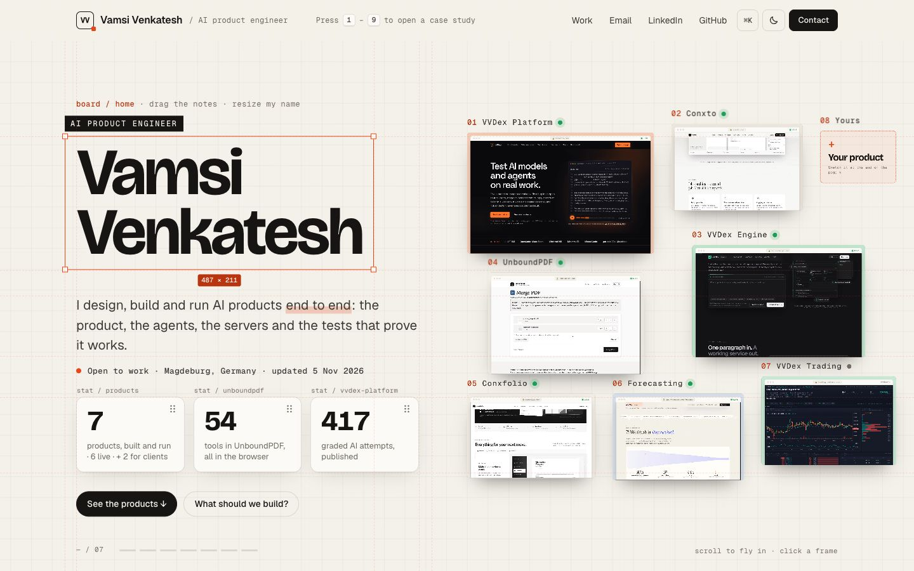
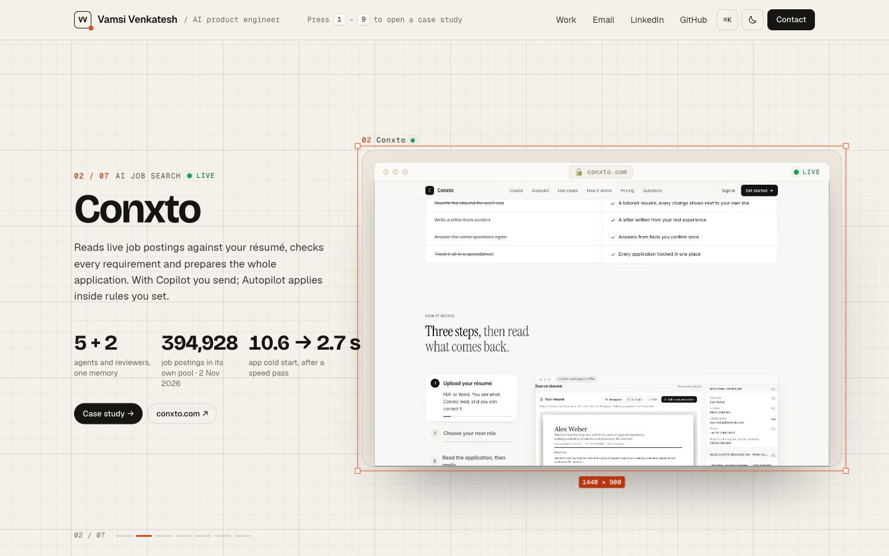
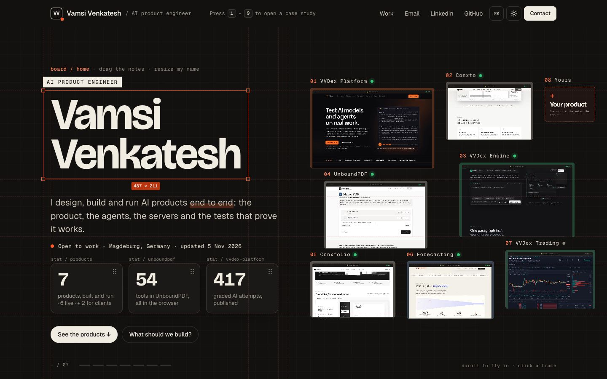
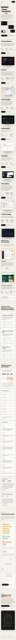

# The Board: portfolio design

My next portfolio design. The homepage is a board of live product frames: seven products I run, each playing its real screen, plus an empty frame **08 · Yours** that leads to a playground where a visitor drafts their own project. Scrolling is one camera that flies into each product in turn.



## How it works

- **One camera.** Scrolling flies the camera from frame to frame; the copy appears only up close. A 0.2 s damper turns fast flicks into single flights, and the graph-paper grid zooms with the camera (`boardCamera()` in `assets/site.js`).
- **Frames you can use.** Click a far frame to fly to it; click the frame in focus to open its case study, with the frame and title morphing into the case page. Frames can be dragged, resized and reset.
- **Frame 08.** Jumps to the playground, where tapping notes builds a draft brief.
- **⌘K / Ctrl+K** opens a command bar: products, sections, contact, theme.
- **Light and dark.** The board's grid and every colour follow the theme.
- **Phones and reduced motion** get the board small and still: seven posters plus the dashed 08, tap to jump to a product.

| Up close | Dark | iPhone 13 |
| --- | --- | --- |
|  |  |  |

## Build

```bash
node tools/build.mjs     # renders index.html and work/<slug>/index.html from content.json
npx serve .
```

`content.json` holds every product's facts; `tools/build.mjs` fails loudly if the product count changes, so the board and the case pages cannot drift apart.

## Verification

Checked with Playwright before each version was shown:

- **Desktop** (Chrome, 1920×1080 and 1440×900): 0 console errors, 0 px horizontal overflow, all 7 loops playing; 20 page loads with 0 problems.
- **Mobile** (WebKit: iPhone 13, iPhone 12 mini, iPhone SE at 320 px): 12 page loads with 0 overflow, 0 errors and 0 contrast failures.
- The mobile pass found and fixed 46 px of sideways overflow at 320 px, 67 tap targets under 44 px, and four text colours under 4.5:1 contrast.

The check scripts are in `tools/` (`check-home.mjs`, `check-board.mjs`, `check-mobile.mjs`).

## History

The commits are the four versions as they were saved on 5 November 2026:

1. **v1**: a live build board built from seven references, one page per product.
2. **v2**: up-to-date product content, motion and playgrounds; client work separated from products.
3. **v3**: every product shown once; the hero became an end-to-end board.
4. **v4.1**: the board is the homepage. Count-up numbers and the repeated fade-in on every section were removed, and the mobile pass above was done.

## Status

A design in review, run locally. The live site is still [vamsivenkatesh.com](https://vamsivenkatesh.com).
